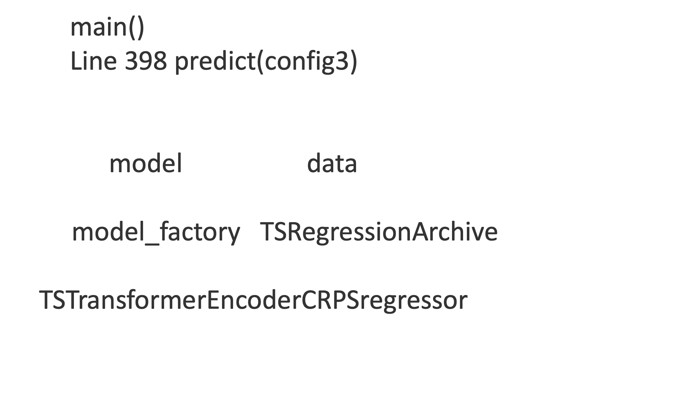

This folder contains all the code and instructions about load trained models and utilzie the model to forecast. 
**Put model_load_example.py** in the same **directory** as **main.py**. 
Since everything related to the model is **pre-defined**, the best way to reload the models is to utilize existing functions. 
Saving the entire model requires to exactly recreate the same file structure (including the source code of the model) on the target system, which is quite brittle. 
So during the training process only the parameters (state_dict) are stored.  

In the main.py, at line 398, the predict(configs) load the model and predict the future loads. 
**model_load_example.py** utilize the functions from **main.py**. 
Check model_load_example.py and the comments for more details.
